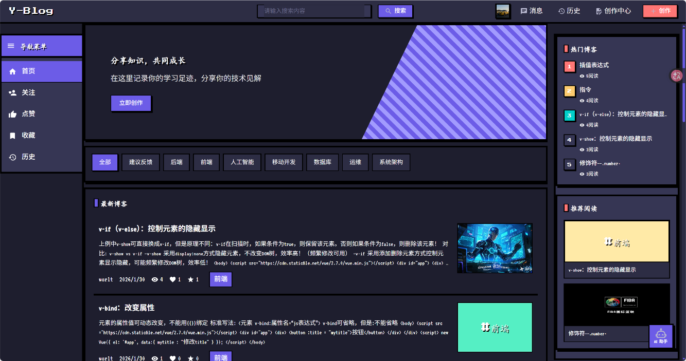
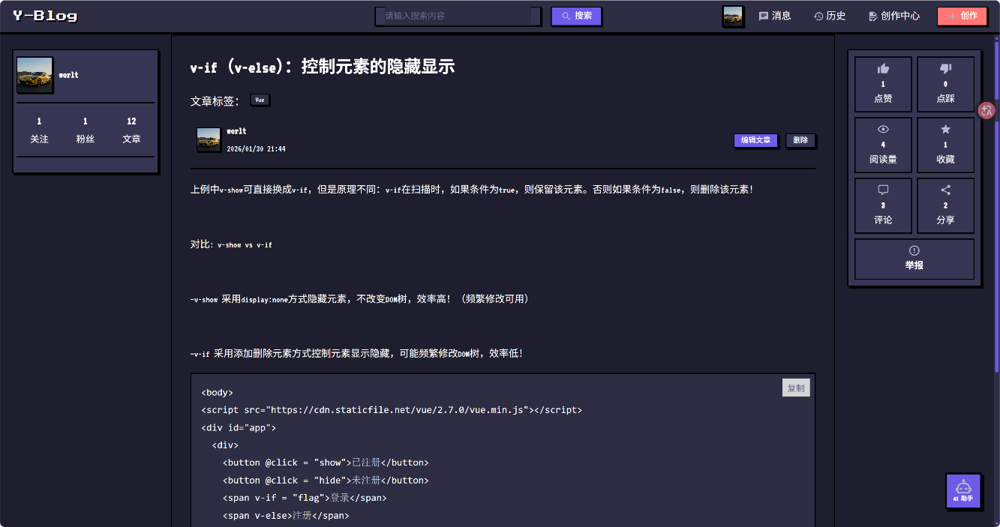
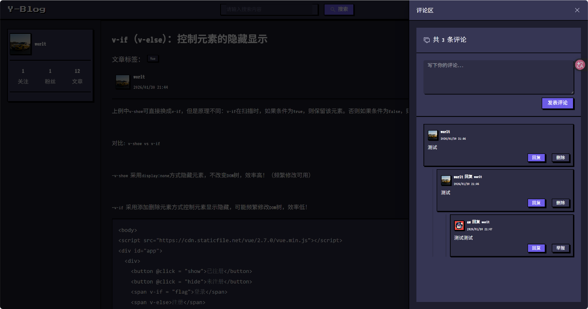
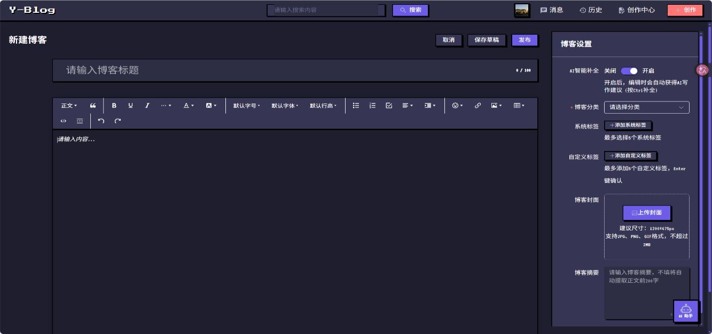
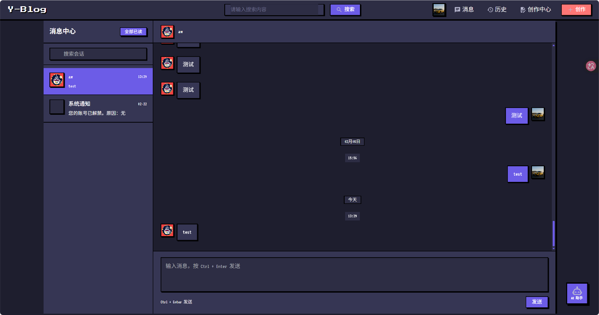
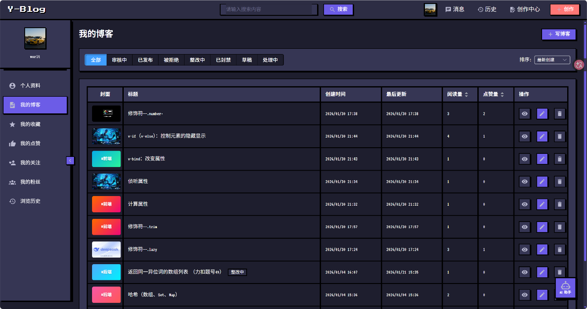
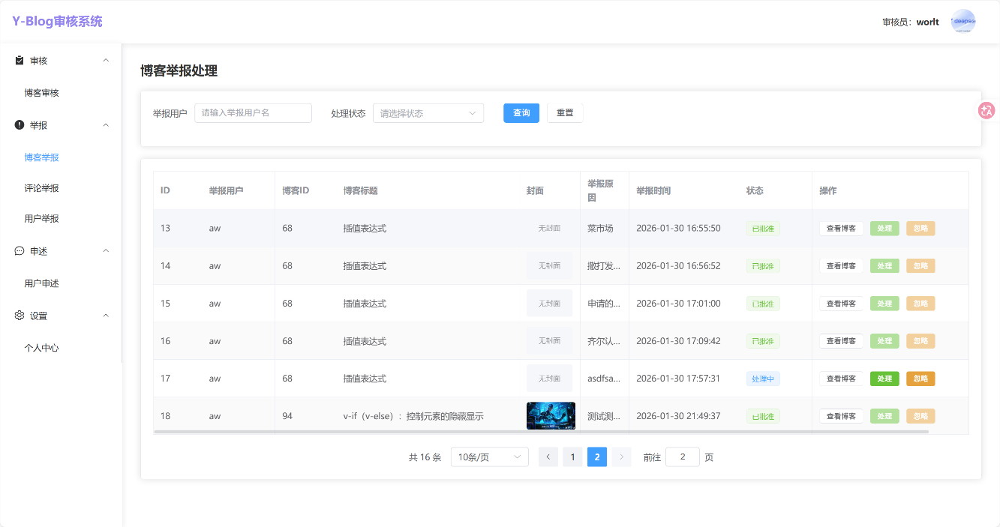
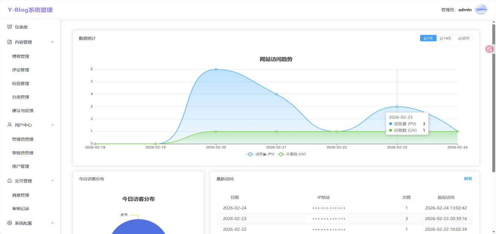

<p align="center">
  
</p>

<h1 align="center">Y-Blog · Frontend</h1>

<p align="center">一个前后端分离的博客社区，包含像素风用户端、管理端与审核端。</p>

<p align="center">
  
  
  
</p>

<p align="center">
  <a href="https://github.com/worlt/Y-Blog-Backend">后端仓库</a> ·
  <a href="#界面预览">界面预览</a> ·
  <a href="#快速开始">快速开始</a> ·
  <a href="#部署说明">部署说明</a> ·
  <a href="SECURITY.md">安全与隐私</a>
</p>

## 项目介绍

Y-Blog 不只是文章展示页面，还包含内容创作、社区互动、即时私信和内容审核等功能。本仓库维护三个独立的 Vue 应用，通过同一套后端 API 协作；`common/` 提供共享的请求、错误处理及认证辅助工具。

这是个人学习与实践项目，适合了解 Vue 3 与 Spring Boot 的前后端协作。生产使用前，请阅读 [安全说明](SECURITY.md)，完成自己的配置、依赖与安全评估。

## 功能概览

| 应用 | 功能 |
| --- | --- |
| 用户端 `blog_user` | 注册登录、邮件验证、滑块验证码、文章浏览与搜索、分类标签、富文本创作、个人中心 |
| 社区互动 | 点赞、点踩、收藏、评论与回复、关注、举报、申诉、建议反馈与投票 |
| 即时私信 | 会话列表、WebSocket 消息、未读提示、消息撤回 |
| AI 辅助 | AI 对话入口，需配置后端 AI 服务 |
| 管理端 `blog_admin` | ECharts 数据看板、文章与评论管理、标签分类、账户管理、权限及网站设置 |
| 审核端 `blog_auditor` | 文章审核、文章/评论/用户举报处理、用户申诉与审核员个人设置 |

具体行为以当前源码及后端接口为准；邮件、对象存储和 AI 功能需要部署者提供对应服务。

## 界面预览

以下截图展示用户端、审核端与管理端的实际界面。截图内容为演示时的页面状态，管理看板中的 IP 地址已脱敏。

### 用户端

**首页与内容发现**：像素风首页整合文章列表、分类导航、热门博客与推荐阅读。



#### 文章详情、评论互动与富文本创作

**文章详情**：展示文章正文、代码块、作者信息，以及点赞、收藏、分享和举报入口。



**评论互动**：侧边评论区支持发表评论、回复、删除与举报。



**富文本创作**：编辑正文，设置分类、标签、封面与摘要，并保存草稿或发布文章。



#### 即时私信与个人创作中心

**消息中心**：提供会话搜索、聊天记录、消息输入与系统通知入口。



**个人创作中心**：按文章状态筛选自己的博客，查看阅读和点赞数据，并进行预览、编辑或删除。



### 审核端

**博客举报处理**：按举报用户和处理状态筛选记录，查看被举报内容并进行处理或忽略。



### 管理端

**数据仪表盘**：展示网站访问趋势、浏览量（PV）、访客数（UV）与访问记录，侧边栏提供内容、账户和系统配置入口。



## 技术栈

- **界面与路由**：Vue 3、Vue Router 4、Element Plus、Iconify。
- **状态与请求**：Pinia、持久化插件、Axios。
- **内容编辑**：wangEditor、Vue Quill、Markdown 渲染与 Highlight.js。
- **数据可视化**：ECharts（管理端）。
- **开发构建**：Vite 6、npm；三个应用各自维护 `package.json` 和锁文件。

## 仓库结构

```text
Y-Blog-Frontend/
├── blog_user/       # 用户端，默认端口 2002
├── blog_admin/      # 管理端，默认端口 2000
├── blog_auditor/    # 审核端，默认端口 2001
├── common/          # 共享工具，被三个应用通过 @common 引用
├── docs/images/     # README 界面截图
├── README.md
├── SECURITY.md
├── NOTICE
└── LICENSE
```

> 请克隆完整仓库。只复制某个应用目录会丢失 `@common` 引用的共享代码。

## 当前已知限制

干净克隆后，仅在三个应用内分别运行 `npm ci`，构建可能仍会失败：`common/` 的共享文件导入 `element-plus` 等依赖，但仓库目前没有根 workspace 或共享目录依赖清单，打包器无法从共享文件所在位置解析这些包。本次文档整理的三端构建验证均遇到了这一问题。

下面列出的是现有应用的安装与启动命令，**不是已验证可完成全部页面联调的开箱即用流程**。正式部署前，需要先整理共享依赖及模块去重，再重新验证三个应用；不建议通过把 `element-plus` 设为 external 来绕过问题。

## 快速开始

### 1. 准备环境

- Node.js **22.x** 与 npm。
- 已启动的 [Y-Blog 后端](https://github.com/worlt/Y-Blog-Backend)，开发环境默认监听 `8088`。
- 本地 MySQL、Redis 及第三方服务由后端负责配置。

### 2. 获取源码

```bash
git clone https://github.com/worlt/Y-Blog-Frontend.git
cd Y-Blog-Frontend
```

### 3. 安装并启动

在三个独立终端中分别执行：

**用户端**

```bash
cd blog_user
npm ci
npm run dev
```

**管理端**

```bash
cd blog_admin
npm ci
npm run dev
```

**审核端**

```bash
cd blog_auditor
npm ci
npm run dev
```

| 应用 | 本地地址 | 后端令牌请求头 |
| --- | --- | --- |
| 用户端 | `http://localhost:2002` | `userToken` |
| 管理端 | `http://localhost:2000` | `adminToken` |
| 审核端 | `http://localhost:2001` | `auditorToken` |

首次使用请按后端 README 初始化数据库和账户。源码仓库没有提供真实账户或生产数据库。

### 4. 前后端联调

三个应用的 `vite.config.js` 都会把 `/api` 请求代理至 `http://localhost:8088`，并去除 `/api` 前缀。例如 `/api/user/...` 会转发到后端的 `/user/...`。

- 后端端口变化时，分别调整三个 Vite 配置的 `server.proxy['/api'].target`。
- 本地私信连接为 `ws://localhost:8088/ws/{userId}`。如后端端口变化，还需检查 `blog_user/src/utils/websocket.js`。
- 非本地环境的私信地址当前使用作者的部署域名。自部署前必须在上述 WebSocket 文件中替换为自己的服务地址。
- `server.allowedHosts` 中保留的是原部署域名。使用自定义开发域名时，改为自己信任的域名，不要无条件允许所有 Host。

前端环境变量和构建产物对浏览器用户可见，**不要在前端放置 SMTP 密码、对象存储私钥、AI API Key 或 JWT 签名密钥**。当前项目不通过 `.env` 自动配置 API 地址，联调设置以现有 Vite 与 WebSocket 配置为准。

## 构建与部署

在每个应用目录分别执行：

```bash
npm run build
npm run preview
```

每个应用的静态产物分别位于自己的 `dist/`。`preview` 只用于检查构建结果，不替代生产 Web 服务器。

### 部署说明

三个应用使用 HTML5 History 路由。生产 Web 服务器需要：

1. 为用户端、管理端和审核端配置独立站点或合适的路由入口。
2. 将不存在的前端路径回退到 `index.html`，避免刷新页面时出现 404。
3. 将 `/api/` 反向代理到后端，并按开发环境约定移除此前缀。
4. 为 `/ws/` 配置 WebSocket Upgrade，并同步修改用户端 WebSocket 地址。
5. 启用 HTTPS/WSS，限制后台访问范围，不使用 Vite 开发服务器承载生产流量。

## 开发与贡献

- 各应用的 `npm ci`、`npm run dev`、`npm run build`、`npm run preview` 相互独立。
- 修改 `common/` 后，需要检查三个应用，而不仅是当前正在运行的页面。
- 提交 Issue 时说明应用、复现步骤、浏览器版本及**脱敏**后的错误信息。
- 欢迎通过 PR 提交修复和改进；提交前至少运行受影响应用的构建。
- 本仓库目前没有单独的前端自动化测试脚本，构建通过不代表所有业务交互都经过验证。

## 许可证

本仓库原创代码采用 **GNU Affero General Public License v3.0 only**，SPDX 标识为 **`AGPL-3.0-only`**。完整条款见 [LICENSE](LICENSE)，版权声明见 [NOTICE](NOTICE)。

AGPL 允许学习、修改、分发和商业使用。分发修改版、或让用户通过网络使用修改版时，应遵守相应的源码提供、许可证及版权声明义务。`only` 表示限定第 3 版，而不是自动允许使用未来版本；具体义务以许可证原文为准。

第三方依赖和素材仍适用各自的许可证。本项目采用 AGPL 不代表可以忽略依赖或图片素材的版权要求。

## 作者

**worlt** · [GitHub](https://github.com/worlt) · **2516930419@qq.com**

安全问题请私下报告，不要在公开 Issue 中粘贴敏感信息。
